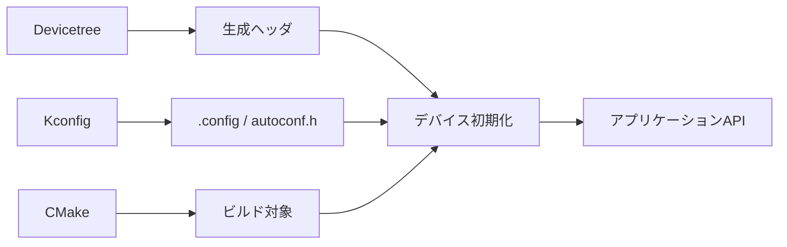

# Zephyr内部構造解説の索引

> **概要: このノートの使い方**
>
> Zephyrの設定、生成物、起動、デバイス、APIを順にたどり、最終的にアプリケーションの一行をソースツリーまで追跡します。

## 学習ロードマップ

このノートは、すべてを順番に暗記するためのものではありません。各段階の完了条件を満たしたら次へ進み、必要になった機能だけを段階 4 で深掘りします。

| 段階 | 目的 | 完了条件 | 主な記事 |
| --- | --- | --- | --- |
| 準備 | Cの記法を読める | `struct`、pointer、`const`、`NULL`を自分の言葉で説明できる | [Cの最小基礎](../01-Cの基礎/00-Cの最小基礎.md)、[ポインタと構造体からZephyrを読む](../01-Cの基礎/01-ポインタと構造体.md) |
| 0 | 観察環境を再現する | nRF52840 DK 向けにBlinkyをビルドし、`zephyr.dts`、`.config`、`zephyr.elf`を開ける | [nRF Connect for VS Codeで観察する](../02-開発環境/01-nRF Connect for VS Codeで観察する.md)、[成果物を読む](../02-開発環境/05-成果物を読む.md) |
| 1 | 構成を説明する | application、board、Zephyr、module、build directoryと、CMake・Kconfig・Devicetreeの役割を区別できる | [ワークスペースの構造](../02-開発環境/03-ワークスペースの構造.md)、[ビルドパイプライン](../04-ビルドと設定/00-ビルドパイプライン.md) |
| 2 | API経路を追跡する | GPIOまたはUARTの呼出を、入力設定からdriverとELFまで追える | [導入環境からBlinkyを追う](../08-追跡演習/01-導入環境からBlinkyを追う.md)、[GPIO呼び出しを追う](../08-追跡演習/03-GPIO呼び出しを追う.md) |
| 3 | 実行時の仕組みを説明する | thread、ISR、work queue、同期の実行コンテキストを区別し、`main()`までの初期化経路を説明できる | [初期化](../05-カーネル/01-初期化.md)、[実行コンテキスト](../05-カーネル/02-実行コンテキスト.md) |
| 4 | 機能を調査・変更する | sample、設定、実装、testを根拠に、一つのサブシステムを変更・確認できる | [Zephyr提供機能の地図](../07-サブシステム/01-機能地図.md) |

> **注記: どこまで学ぶか**
>
> Zephyrを使い始めるには段階2まで、内部構造を前提に設計判断するには段階3までが共通範囲です。段階4では、必要になった機能だけを選びます。全driverや全subsystemを読む必要はありません。

## 番号の読み方

各chapterのdirectory名と各記事名は、推奨する順番で`00-`、`01-`のように始まります。まず小さい番号の記事を読み、途中で理解が難しければ前の番号へ戻ってください。`00-この章について`は、そのchapterで何を学ぶかを示す案内です。

## 推奨する読書順

| 全体順 | 読むもの | 目的 |
| --- | --- | --- |
| 1 | [このノートの読み方](01-このノートの読み方.md)、[用語集](02-用語集.md) | ノートの約束と用語を確認する |
| 2 | [Cの最小基礎](../01-Cの基礎/00-Cの最小基礎.md) | 構造体、pointer、`const`の最小例を読む |
| 3 | [ポインタと構造体からZephyrを読む](../01-Cの基礎/01-ポインタと構造体.md)、[組込みCとZephyrの実装パターン](../01-Cの基礎/02-Zephyrの実装パターン.md) | Cの形をZephyrのdevice、macro、linkerへ結び付ける |
| 4 | [導入と開発環境](../02-開発環境/00-この章について.md)から[開発・解析コマンド](../02-開発環境/06-開発・解析コマンド.md)まで | build入力と生成物を観察できるようにする |
| 5 | [ソースツリー地図](../03-ソースツリー/00-ソースツリー地図.md)、[ビルドパイプライン](../04-ビルドと設定/00-ビルドパイプライン.md)、[Kconfig](../04-ビルドと設定/01-Kconfig.md)、[Devicetree](../04-ビルドと設定/02-Devicetree.md) | source treeとbuild設定の関係をつかむ |
| 6 | [初期化](../05-カーネル/01-初期化.md)、[実行コンテキスト](../05-カーネル/02-実行コンテキスト.md)、[デバイスモデル](../06-ハードウェア抽象化/01-デバイスモデル.md) | 実行時にdeviceとAPIがつながる経路を追う |
| 7 | [導入環境からBlinkyを追う](../08-追跡演習/01-導入環境からBlinkyを追う.md)、[Blinkyの設定差分を観察する](../08-追跡演習/02-Blinkyの設定差分を観察する.md) | 実際の入力と生成物を一続きで確認する |

## 追跡演習

- [GPIO呼び出しを追う](../08-追跡演習/03-GPIO呼び出しを追う.md)
- [UARTとコンソールを追う](../08-追跡演習/04-UARTとコンソールを追う.md)
- [導入環境からBlinkyを追う](../08-追跡演習/01-導入環境からBlinkyを追う.md)
- [Blinkyの設定差分を観察する](../08-追跡演習/02-Blinkyの設定差分を観察する.md)
- [実行コンテキストを観察する](../08-追跡演習/05-実行コンテキストを観察する.md)
- [ボード差分を観察する](../08-追跡演習/06-ボード差分を観察する.md)

## 深掘りシリーズ

最初に[Zephyr提供機能の地図](../07-サブシステム/01-機能地図.md)で入口を選び、基礎コースを横断する[ログ](../07-サブシステム/02-ログ.md)へ進みます。

## 検証の原則

すべてのソース参照は[`v4.4.2`](https://github.com/zephyrproject-rtos/zephyr/tree/v4.4.2)に固定します。確認した公式URLとローカル検証の基準は[Zephyr v4.4.2 参照台帳](../_references/v4.4.2.md)にあります。
