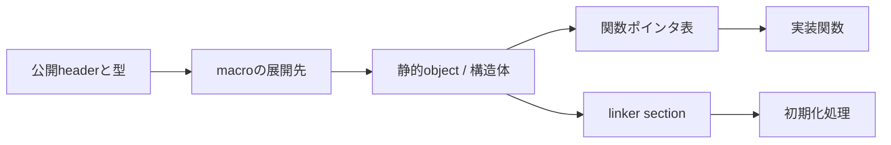

# ポインタと構造体からZephyrを読む

## 対象範囲

PythonやRustを主に使ってきた読者が、Zephyrの内部を追うために必要なポインタ、構造体、関数ポインタの読み方を扱います。C言語の最初の構文は[Cの最小基礎](00-Cの最小基礎.md)を先に読んでください。所有権や型安全性をRustと同じ形で再現する方法、C++の利用は扱いません。

## 前提知識

[Cの最小基礎](00-Cの最小基礎.md)の構造体、ポインタ、`const`を理解していることを前提にします。Zephyr固有のmacroとlinkerの使い方は[組込みCとZephyrの実装パターン](02-Zephyrの実装パターン.md)を続けて読んでください。

## 全体像

Pythonではmodule import、Rustでは型とtrait実装が関係を表す場面でも、ZephyrのCではheader、macro、構造体、関数ポインタ、linker sectionが分担します。最初に全展開を読もうとせず、公開APIから「型」「実装表」「登録」を順に確認します。



## ディレクトリとファイル

| パス | 役割 | 最初に見るもの |
| --- | --- | --- |
| `include/zephyr/` | 公開APIと公開型の入口 | 関数宣言、引数、戻り値、関連する`struct` |
| `include/zephyr/drivers/` | driver APIと型別の関数ポインタ表 | `struct ..._driver_api`とinline wrapper |
| `include/zephyr/sys/` | macro、container、atomicなどの共通部品 | macroの引数と展開先 |
| `kernel/` | kernel objectと実行時の実装 | `struct k_thread`、scheduler、init |
| `drivers/` | SoC/周辺機能別の実装とdevice登録 | `DEVICE_DT_DEFINE()`とAPI表 |

## 処理の流れ

> **注記: コード例の読み方**
>
> 次の断片は概念を示すために簡略化しています。実際のdriver API・macro定義は、各断片の後に示すheaderまたはsourceで確認してください。

1. **最初に引数の型を見る。** たとえば`const struct device *dev`は、「既に作られた`struct device`を指すポインタ」です。関数へ渡されるのはdevice全体のコピーではなく、その置き場所を示すアドレスです。まず`include/zephyr/device.h`を開き、`struct device`がどの情報を持つobjectかを確認します。

   ```c
   static const struct device *const led =
       DEVICE_DT_GET(DT_ALIAS(led0));

   void check_led(const struct device *dev)
   {
       /* devとledは、同じdevice objectを指し得る。 */
       if (!device_is_ready(dev)) {
           return;
       }

       /* devの実体をコピーせず、このdeviceを使う。 */
   }

   check_led(led);
   ```

   `check_led()`に渡るポインタ値そのものはコピーされますが、`struct device`本体はコピーされません。したがって、`dev`をたどれば、driverが登録した既存のdeviceを参照します。

2. **`const`が何を変更禁止にするかを読む。** `const struct X *p`では、`p`が指す`struct X`を`p`経由で変更できません。一方の`struct X * const p`では、`p`が指す先を別の`struct X`へ付け替えられません。前者は「device本体を変更しない」、後者は「このポインタ変数を付け替えない」と覚えると区別しやすくなります。

   ```c
   struct setting {
       int value;
   };

   struct setting writable = { .value = 1 };
   const struct setting *read_only = &writable;
   struct setting *const fixed_pointer = &writable;

   /* read_only->value = 2; */      /* 不可: 指すobjectはread-only */
   fixed_pointer->value = 2;        /* 可: object自体は変更できる */
   /* fixed_pointer = NULL; */      /* 不可: ポインタを付け替えられない */
   ```

3. **API呼出の次は関数ポインタ表を見る。** GPIOのようなdriver APIは、`dev`から得たAPI表にある関数ポインタを呼びます。公開headerのwrapperから`dev->api`をたどり、その表を設定しているdriver sourceを探すと、「同じGPIO APIがboardごとに別driverへ届く」理由を追えます。Rustのtrait objectと似ていますが、Cでは表と関数の型が正しいことを自分で確認します。

   次は`gpio.h`の実装を単純化した概念例です。

   ```c
   struct example_driver_api {
       int (*toggle)(const struct device *dev, unsigned int pin);
   };

   int example_toggle(const struct device *dev, unsigned int pin)
   {
       const struct example_driver_api *api =
           (const struct example_driver_api *)dev->api;

       return api->toggle(dev, pin);
   }
   ```

   `example_toggle()`自身はpinを操作しません。`dev->api`が指す表から`toggle`を取り出して呼ぶため、実装を追う次の場所は`example_driver_api`の実体を定義しているdriver sourceです。

   > [!tip] API表は「機能の電話帳」
   > `struct example_driver_api`は、GPIO driverが実行できる操作と、その実装関数の住所を並べた**電話帳**です。applicationは特定のchip用関数名を知る必要がありません。`toggle`という項目から電話番号（関数の住所）を取り出して呼ぶため、同じAPIで別のchip用driverを使えます。

   `int (*toggle)(const struct device *dev, unsigned int pin);`は、内側から外へ読むと分かりやすくなります。

   1. `toggle`はmemberの名前です。
   2. `*toggle`は、通常の値ではなく**関数を指すpointer**です。
   3. `(*toggle)(const struct device *dev, unsigned int pin)`は、`const struct device *`と`unsigned int`を受け取る関数を指します。
   4. 先頭の`int`は、その関数が`int`を返すことを表します。Zephyrのdriver APIでは、0が成功、負の値がerrorを表す関数が多くあります。ただし、個別APIの戻り値規約は公開headerで確認します。

   実装側では、実際の関数とAPI表を次のように用意します。これは説明用の簡略化例です。

   ```c
   static int chip_toggle(const struct device *dev, unsigned int pin)
   {
       /* devからchip固有の設定を取り出し、pinを反転する。 */
       return 0;
   }

   static const struct example_driver_api chip_api = {
       .toggle = chip_toggle,
   };
   ```

   `.toggle = chip_toggle`は、電話帳の`toggle`欄へ`chip_toggle`関数の住所を登録する記述です。`struct device`を作るときに、そのdeviceの`api`が`chip_api`を指すようにします。

   ```mermaid
   flowchart LR
       DEV["struct device<br/>api = chip_api"] --> TABLE["chip_api<br/>toggle = chip_toggle"]
       TABLE --> FUNC["chip_toggle(dev, pin)"]
   ```

   呼出時の各行は次の意味です。

   ```c
   const struct example_driver_api *api =
       (const struct example_driver_api *)dev->api;
   ```

   `dev->api`は「このdeviceが使うAPI表の住所」です。`struct device`の`api`は汎用的な型で保持されるため、この例では`example_driver_api`型の表として読むためにcastしています。次の行の`api->toggle(dev, pin)`は、`api`が指す表の`toggle`欄に登録された関数を、`dev`と`pin`を渡して呼びます。`dev`をもう一度渡すのは、driver関数が「どのdeviceを操作するか」と、そのdevice固有の設定を知るためです。

   > [!warning] API表を自分で書き換えない
   > applicationが`dev->api`や関数pointerを変更するものではありません。Zephyrのdriverが初期化時に用意する表を、公開APIを通じて読むだけです。`api`または`api->toggle`が未設定の可能性を想定して独自に呼ぶのではなく、通常は`gpio_pin_toggle()`のような公開wrapperから使います。

4. **objectがいつまで存在するかを確認する。** file scopeの`static` objectは、そのC fileの外から名前で参照できず、通常はprogramが動いている間ずっと存在します。`DEVICE_DT_DEFINE()`や`K_THREAD_DEFINE()`は、このようなobjectをbuild時に作り、Zephyrが初期化または実行できるように登録します。

   ```c
   static int completed_jobs;

   void record_job(void)
   {
       completed_jobs++;
   }
   ```

   この`completed_jobs`は`record_job()`が返っても消えず、program終了まで残ります。ただし、別のthreadやISRからも更新するなら、この例のような単純な`++`だけでは安全ではありません。

   ```c
   K_THREAD_DEFINE(worker, 1024, worker_entry,
                   NULL, NULL, NULL, 7, 0, 0);
   ```

   `K_THREAD_DEFINE()`は、thread object、stack、entry functionをbuild時に用意して登録するZephyrのmacroです。`worker_entry`の実行開始は、この行を通る初期化・schedulerの経路から追います。

5. **macroは「値」ではなく「生成された式」として扱う。** `DT_*`はDevicetreeから、`CONFIG_*`はKconfigから作られます。C sourceで展開結果を想像し続けるのではなく、実際のbuildが出力した`zephyr.dts`と`.config`で、どの入力がどの値になったかを確認します。

   ```c
   #define LED_NODE DT_ALIAS(led0)

   static const struct gpio_dt_spec led =
       GPIO_DT_SPEC_GET(LED_NODE, gpios);

   if (IS_ENABLED(CONFIG_GPIO)) {
       /* CONFIG_GPIOが有効なbuildだけで使う処理 */
   }
   ```

   `DT_ALIAS(led0)`がどのnodeになるかは、選んだboardとoverlayで決まります。`CONFIG_GPIO`が有効かは、`prj.conf`だけではなく依存関係を解決した後の`build/zephyr/.config`で確認します。

6. **分からない型・macroは定義へ戻る。** `git grep`またはエディタの定義ジャンプで、公開headerの宣言、macroの定義、driver側の実装を順に確認します。Cは「ポインタがnullでない」「呼出元がISRではない」といった条件を型だけでは十分に表せないため、API文書と呼出コンテキストも併せて確認します。

   ```sh
   # 公開APIとAPI表を確認する
   git grep -n 'gpio_pin_toggle_dt' -- include/zephyr/drivers/gpio.h
   git grep -n 'struct gpio_driver_api' -- include/zephyr/drivers/gpio.h

   # API表を登録するdriverを探す
   git grep -n 'gpio_driver_api' -- drivers/gpio
   ```

   この順で読むと、`gpio_pin_toggle_dt()`から「どの関数ポインタを呼ぶか」、さらに「選んだboardではどのdriverがその表を登録するか」を分けて追えます。

> **注記: Rustとの重要な差**
>
> Cのポインタには所有者・寿命・排他の情報が型としてありません。ZephyrではAPI documentation、`const`、呼出コンテキスト、Kconfig、static objectの配置を合わせて読んで初めて有効条件を判断できます。

## 設定との対応

| C上の見え方 | 根拠を確認する場所 | 判断すること |
| --- | --- | --- |
| `CONFIG_FOO` | `.config`、`Kconfig` | 機能が有効か、依存条件は何か |
| `DT_*` | `zephyr.dts`、binding、generated header | node・property・aliasが何を指すか |
| `DEVICE_DT_DEFINE()` | node、driver source、`device.h` | device objectと初期化entryが作られるか |
| `K_THREAD_DEFINE()` | `kernel.h`、Kconfig、map file | thread object・stack・entry pointがどこに置かれるか |
| `struct ..._driver_api` | 公開header、driver source | wrapperが最終的に呼ぶ実装 |

## 確認方法

GPIO APIから関数ポインタ表と登録を追う例です。

```sh
cd <workspace>/zephyr
git grep -n 'struct gpio_driver_api' -- include/zephyr/drivers/gpio.h
git grep -n 'gpio_pin_toggle_dt' -- include/zephyr/drivers/gpio.h
git grep -n 'DEVICE_DT_DEFINE' -- drivers/gpio
git grep -n 'K_THREAD_DEFINE' -- include/zephyr/kernel.h
```

`git grep`の結果を読んだら、選んだboardの`build/zephyr/zephyr.dts`と`build/zephyr/.config`を開き、macroの入力が実際のbuildで有効かを確認します。

## 関連項目

- [組込みCとZephyrの実装パターン](02-Zephyrの実装パターン.md)
- [Kconfig](../04-ビルドと設定/01-Kconfig.md)
- [Devicetree](../04-ビルドと設定/02-Devicetree.md)
- [デバイスモデル](../06-ハードウェア抽象化/01-デバイスモデル.md)

## 参照元

- [`kernel.h` v4.4.2](https://github.com/zephyrproject-rtos/zephyr/blob/v4.4.2/include/zephyr/kernel.h)
- [`device.h` v4.4.2](https://github.com/zephyrproject-rtos/zephyr/blob/v4.4.2/include/zephyr/device.h)
- [`gpio.h` v4.4.2](https://github.com/zephyrproject-rtos/zephyr/blob/v4.4.2/include/zephyr/drivers/gpio.h)
- [Threads v4.4.2](https://docs.zephyrproject.org/4.4.2/kernel/services/threads/index.html)
