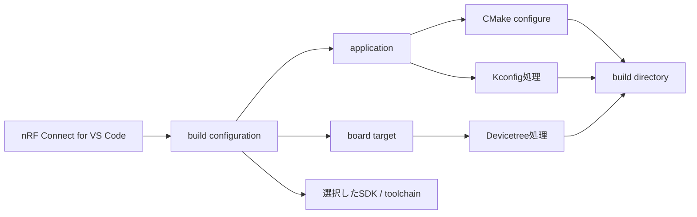

# nRF Connect for VS Codeで観察する

## 対象範囲

nRF Connect for VS Codeを、nRF52840 DK向けのZephyr applicationを構成・ビルドし、生成物を観察する入口として使います。拡張機能の導入障害、特定のnRF Connect SDK（NCS）版の選択、Nordic固有ライブラリのAPIは扱いません。

> **注意: NCSとupstream Zephyrを同一視しない**
>
> nRF Connect for VS CodeはNCSを選択してbuildできます。NCSに含まれるZephyr派生ツリーと、このノートが根拠にするupstream Zephyr `v4.4.2`は、revisionや追加moduleが一致するとは限りません。ソースを追うときは、VS Codeが選んだSDKのZephyrと、その記事の対象タグを必ず区別します。

## 前提知識

[導入手順と確認](02-導入手順と確認.md)、[ワークスペースの構造](03-ワークスペースの構造.md)、[成果物を読む](05-成果物を読む.md)を先に確認します。VS Codeの基本的なフォルダ操作と、applicationのルートに`CMakeLists.txt`と`prj.conf`があることを前提にします。

## 全体像

拡張機能はbuild configurationを作るためのUIです。実際に構成を決める入力と、CMakeが出力する生成物の関係は、command lineで`west build`を使う場合と同じです。



## ディレクトリとファイル

| 配置 | 役割 | 観察時の注意 |
| --- | --- | --- |
| application rootの`CMakeLists.txt` | applicationをZephyr CMake buildへ接続する入口 | UIの設定ではなく、ソースに保存される入力 |
| application rootの`prj.conf` | Kconfig fragment | build configurationで追加fragmentを指定した場合は、それも入力になる |
| applicationの`.overlay` | boardに対するDevicetree差分 | 適用対象boardを確認する |
| build directoryの`CMakeCache.txt` | CMakeが決定した構成 | UIの選択が実際に反映されたかを確認する |
| `build/zephyr/.config` | 解決済みKconfig | `prj.conf`を編集する前後で比較する |
| `build/zephyr/zephyr.dts` | 解決済みDevicetree | boardとoverlayの結合結果を確認する |
| `build/zephyr/zephyr.elf` | link結果 | symbol、section、デバッグ情報を追う対象 |

## 処理の流れ

1. VS Codeでapplicationを開き、nRF52840 DKを対象にbuild configurationを作成します。SDK、toolchain、board target、追加Kconfig fragment、追加Devicetree overlayは、buildの入力として記録します。
2. buildを実行したら、まずbuild configurationが示すapplication rootとbuild directoryを確認します。前回の異なるboardやSDKの出力を読まないためです。
3. `CMakeCache.txt`で、CMakeが認識したboardとapplicationを確認します。次に`.config`と`zephyr.dts`を開き、設定とハードウェア記述の最終結果を確認します。
4. UIに依存しない再確認が必要なときは、同じapplication・board・overlayを入力に[開発・解析コマンド](06-開発・解析コマンド.md)の`west build`で構成します。両者でbuild directoryを共有・上書きせず、出力先を分けます。
5. upstream Zephyrの記事を読むときは、SDK内の`zephyr/`で`git describe --exact-match --tags HEAD`を実行します。`v4.4.2`でなければ、このノートの恒久リンクは概念の参照にとどめ、実際のパスとsymbolはSDK内で再確認します。

## 設定との対応

| UIまたは入力 | Zephyrでの意味 | 生成物での確認先 |
| --- | --- | --- |
| board target | board/SoCのCMake・Devicetree入力を選ぶ | `CMakeCache.txt`、`zephyr.dts` |
| Kconfig fragment | 機能選択の追加入力 | `.config`、`autoconf.h` |
| Devicetree overlay | board記述に加えるハードウェア差分 | `zephyr.dts`、generated DT header |
| SDK/toolchain | 読むソース集合とcompilerを決める | SDK内の`zephyr/`、`CMakeCache.txt` |

## 確認方法

VS CodeでnRF52840 DK向けにBlinkyをbuildした後、build directoryで次を実行します。

```sh
grep -E '^(APPLICATION_SOURCE_DIR|BOARD|ZEPHYR_BASE):' CMakeCache.txt
grep -n 'CONFIG_GPIO' zephyr/.config
grep -nE 'aliases|led0|gpios' zephyr/zephyr.dts
find zephyr -maxdepth 1 -name 'zephyr.elf' -o -name 'zephyr.map'
```

出力のパスはextensionやSDK版で異なり得ます。ファイル名ではなく、CMakeが生成したbuild directoryを起点に確認します。

## 関連項目

- [導入手順と確認](02-導入手順と確認.md)
- [ワークスペースの構造](03-ワークスペースの構造.md)
- [成果物を読む](05-成果物を読む.md)
- [ビルドパイプライン](../04-ビルドと設定/00-ビルドパイプライン.md)
- [導入環境からBlinkyを追う](../08-追跡演習/01-導入環境からBlinkyを追う.md)

## 参照元

- [Application development v4.4.2](https://docs.zephyrproject.org/4.4.2/develop/application/index.html)
- [CMake build system v4.4.2](https://docs.zephyrproject.org/4.4.2/build/cmake/index.html)
- [`CMakeLists.txt` v4.4.2](https://github.com/zephyrproject-rtos/zephyr/blob/v4.4.2/CMakeLists.txt)
