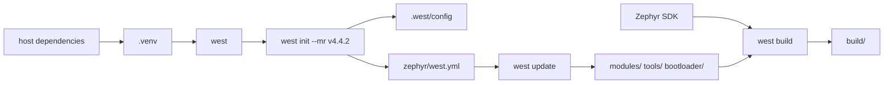

# 導入手順と確認

## 対象範囲

Zephyr v4.4.2を、公式のGetting Started Guideに沿って導入し、内部構造を読むための再現可能な状態を作ります。Linux、macOS、Windowsの依存パッケージ名やデバッグプローブ固有の障害対応は、対象OS向けの公式手順を参照します。

## 前提知識

Git、Python仮想環境（virtual environment）、CMake、クロスコンパイルの基本を前提にします。用語は[用語集](../00-はじめに/02-用語集.md)を参照してください。

## 全体像



`west init`はGit cloneの代替ではなく、複数リポジトリを管理するworkspaceの基点を作ります。`west update`は、その時点のmanifestが固定するrevisionへZephyr本体とmoduleを展開します。SDKはその入力をターゲット向けにコンパイル・リンクする道具を供給します。

## ディレクトリとファイル

| パスまたは要素 | 役割 | 所有者・更新契機 |
| --- | --- | --- |
| `<workspace>/.venv/` | `west`とZephyrのPython依存を隔離するPython環境 | `python -m venv`と`pip`。ソース管理しない |
| `<workspace>/.west/config` | manifest repositoryの場所など、workspace固有のwest設定 | `west init`。通常は手編集せず`west config`を使う |
| `<workspace>/zephyr/` | RTOS本体、既定manifest、CMake・Kconfig・Devicetreeの入力 | `west update`が指定revisionを取得 |
| `<workspace>/zephyr/west.yml` | Zephyrが要求する外部project、配置先、revision、groupを定義 | 対象タグのZephyrリポジトリ |
| SDKの展開先 | compiler、linker、debugger、QEMU、OpenOCDなど | SDKのsetupまたは`west sdk install` |
| `<app>/` | 製品固有の`CMakeLists.txt`、`prj.conf`、overlay、ソース | 開発者が所有 |

## 処理の流れ

1. 対象OSのhost dependencyを入れ、`cmake`、`ninja`、`python3`、`dtc`が実行可能であることを確認します。必要な最低版は対象タグの[Getting Started Guide](https://docs.zephyrproject.org/4.4.2/develop/getting_started/index.html)に従います。
2. `<workspace>/.venv`を作成して有効化し、その環境に`west`を導入します。以後、Python packageをホスト全体へ混在させないため、作業開始時に仮想環境を有効化します。
3. `west init --mr v4.4.2 <workspace>`を実行します。`--mr`はmanifest repository revisionを指定し、ここではZephyrの`v4.4.2`タグを固定します。
4. `<workspace>`で`west update`を実行します。westは`zephyr/west.yml`を読み、`modules/`、`tools/`、`bootloader/`などのprojectを指定path・revisionへ取得します。
5. `west zephyr-export`でZephyr CMake packageをexportし、公式の`west packages pip --install`で対象タグのPython依存を導入します。
6. `zephyr/`から`west sdk install`、または対象版のSDK手順でSDKを導入します。SDKの検出はCMake configure時に行われます。
7. `west build -p always -b <board> samples/basic/blinky`で最小ビルドを行い、[成果物を読む](05-成果物を読む.md)の生成物を確認します。

> **注意: 版を混在させない**
>
> `west init --mr v4.4.2`で取得したZephyrに対して、別リリース向けのSDK要件、Python requirements、module revisionを混在させません。導入時のSDK版・host OS・boardを記録し、更新時は対象タグの公式手順を再確認します。

## 設定との対応

- `west init`が作る`.west/config`の`manifest.path`は、manifest repositoryを指します。上流Zephyr構成では`zephyr`です。
- `zephyr/west.yml`の`self.path: zephyr`と`manifest.projects`が、workspaceでのproject pathと固定revisionを決めます。詳細は[ワークスペースの構造](03-ワークスペースの構造.md)を参照してください。
- SDKを既定外の場所に置く場合、公式SDK文書が定める`ZEPHYR_SDK_INSTALL_DIR`をCMake検出の入力にできます。`ZEPHYR_TOOLCHAIN_VARIANT=zephyr`はSDK選択を明示します。これらは環境依存であり、製品のKconfig設定ではありません。

## 確認方法

```sh
python3 -m venv <workspace>/.venv
. <workspace>/.venv/bin/activate
pip install west
west init --mr v4.4.2 <workspace>
cd <workspace>
west update
west zephyr-export
west packages pip --install
cd zephyr
git describe --exact-match --tags HEAD
west sdk install
west build -p always -b <board> samples/basic/blinky
```

Windowsの仮想環境有効化とSDK setup、OS別host dependencyは、[公式Getting Started Guide](https://docs.zephyrproject.org/4.4.2/develop/getting_started/index.html)の該当節を使います。最後から三つ目のコマンドが`v4.4.2`を返すことを確認してください。

## 関連項目

- [ワークスペースの構造](03-ワークスペースの構造.md)
- [ツールチェーンと開発ツール](04-ツールチェーンと開発ツール.md)
- [導入環境からBlinkyを追う](../08-追跡演習/01-導入環境からBlinkyを追う.md)

## 参照元

- [Getting Started Guide v4.4.2](https://docs.zephyrproject.org/4.4.2/develop/getting_started/index.html)
- [Zephyr SDK v4.4.2](https://docs.zephyrproject.org/4.4.2/develop/toolchains/zephyr_sdk.html)
- [`west.yml` v4.4.2](https://github.com/zephyrproject-rtos/zephyr/blob/v4.4.2/west.yml)
