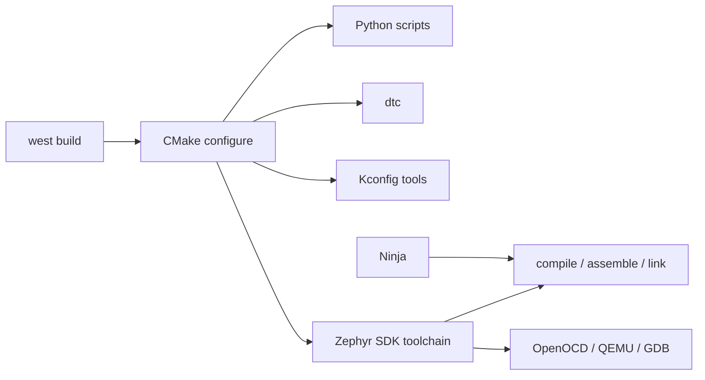

# ツールチェーンと開発ツール

## 対象範囲

Zephyr SDK、Python環境、west、CMake、Ninja、Devicetree compiler（dtc）が、構成からビルドまで担う役割と検出経路を扱います。個別コンパイラの最適化オプションや、特定IDEの設定は扱いません。

## 全体像



`west`はビルドシステム本体ではなく、CMakeとNinjaを呼び出す入口です。CMakeは入力を解析してNinjaの規則を生成し、SDKのcompiler・linkerがターゲット成果物を作ります。

## ディレクトリとファイル

| 要素 | 定義または検出場所 | ビルドへの効果 |
| --- | --- | --- |
| `.venv/` | workspaceのPython仮想環境 | westと生成scriptに必要なPython packageを隔離する |
| `zephyr/scripts/` | Zephyr source | Kconfig、Devicetree、syscall、device dependencyなどの生成処理を支える |
| `zephyr/cmake/` | Zephyr source | toolchain・board・moduleを見つけ、CMake構成を補助する |
| SDK installation | SDK setupまたは`west sdk install` | 各アーキテクチャ用GNU／LLVM toolchainとhost toolを提供する |
| `CMakeCache.txt` | build directory | toolchain、board、CMake変数を含むconfigure結果 |
| `build.ninja` | build directory | CMakeが生成したcompile・link規則。Ninjaが実行する |

## 処理の流れ

1. 仮想環境を有効化して`west`を実行します。`west packages pip --install`で、対象Zephyr版が要求するPython packageを揃えます。
2. `west build`がapp source directory、board、build directoryを受け、必要ならCMake configureを起動します。
3. CMakeが`CMakeLists.txt`を読み、Zephyr package、board、module、toolchainを検出します。結果は`CMakeCache.txt`とNinja入力に記録されます。
4. CMakeからKconfig・Devicetree・Python generatorが実行され、設定ヘッダ、DTマクロ、補助ソースが生成されます。
5. NinjaがSDKのcompiler、assembler、linkerを起動してオブジェクトとELFを作ります。SDKに含まれるQEMU、OpenOCD、GDBなどは、emulation、flash、debugで追加利用されます。

## 設定との対応

| 設定 | 用途 | 注意点 |
| --- | --- | --- |
| `ZEPHYR_TOOLCHAIN_VARIANT=zephyr` | CMakeにZephyr SDKを選ばせる | SDKを選ぶ環境入力。`prj.conf`には書かない |
| `ZEPHYR_SDK_INSTALL_DIR` | 非既定位置のSDKを示す | SDK setupでCMake registryに登録しない場合に使う |
| `ZEPHYR_BASE` | Zephyr source rootを示す | workspace外のfreestanding appで必要になる場合がある。workspace内で安易に恒久設定しない |
| `CMAKE_EXPORT_COMPILE_COMMANDS=ON` | `compile_commands.json`を出力する | IDE・静的解析のためのCMake入力。既存buildにはCMake再実行が必要 |

> **注意: configure結果を手で直さない**
>
> `CMakeCache.txt`、`build.ninja`、生成ヘッダは出力です。SDKの検出、board、CMake引数を変える場合は入力を修正し、`west build -p always`または適切なpristine buildで構成し直します。

## 確認方法

```sh
cd <workspace>/zephyr
west sdk install --help
west build -p always -b <board> samples/basic/blinky \
  -- -DCMAKE_EXPORT_COMPILE_COMMANDS=ON
grep -E 'ZEPHYR_(BASE|SDK_INSTALL_DIR|TOOLCHAIN_VARIANT)' build/CMakeCache.txt
test -f build/compile_commands.json && echo "compile database exists"
```

SDKの具体的な展開先・対応アーキテクチャ・host toolは、[Zephyr SDK v4.4.2](https://docs.zephyrproject.org/4.4.2/develop/toolchains/zephyr_sdk.html)を対象に確認します。

## 関連項目

- [導入手順と確認](02-導入手順と確認.md)
- [成果物を読む](05-成果物を読む.md)
- [ビルドパイプライン](../04-ビルドと設定/00-ビルドパイプライン.md)

## 参照元

- [Zephyr SDK v4.4.2](https://docs.zephyrproject.org/4.4.2/develop/toolchains/zephyr_sdk.html)
- [Application Development v4.4.2](https://docs.zephyrproject.org/4.4.2/develop/application/index.html)
- [CMake build system v4.4.2](https://docs.zephyrproject.org/4.4.2/build/cmake/index.html)
- [`sdk.py` v4.4.2](https://github.com/zephyrproject-rtos/zephyr/blob/v4.4.2/scripts/west_commands/sdk.py)
