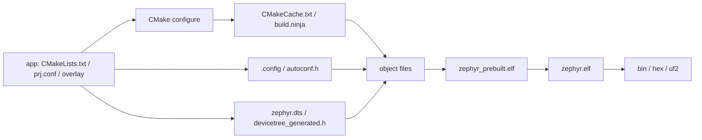

# 成果物を読む

## 対象範囲

`west build`が作るbuild directoryを、設定時、生成時、コンパイル時、リンク時の出力に分けて読みます。出力名はboard、architecture、Kconfig、Devicetree、CMake generatorで異なり得るため、絶対パスではなく生成元との関係を扱います。

## 前提知識

[ツールチェーンと開発ツール](04-ツールチェーンと開発ツール.md)と[ビルドパイプライン](../04-ビルドと設定/00-ビルドパイプライン.md)を読んでください。

## 全体像



## ディレクトリとファイル

| 出力 | 生成元 | 使う段階 | 観察時の問い |
| --- | --- | --- | --- |
| `CMakeCache.txt` | CMake configure | 次回configure、CMake変数の参照 | board、toolchain、source/build directoryは何か |
| `build.ninja` | CMake configure | Ninjaのcompile・link実行 | どの入力変更がどの生成ruleを起動するか |
| `zephyr/.config` | Kconfig | 人間が読む最終設定 | どの`CONFIG_*`が有効か |
| `zephyr/include/generated/zephyr/autoconf.h` | Kconfig | C/C++条件コンパイル | `.config`の値がCでどう見えるか |
| `zephyr/zephyr.dts` | board、SoC、overlay、binding | 人間が読む最終hardware記述 | 選択されたノードとプロパティは何か |
| `zephyr/include/generated/zephyr/devicetree_generated.h` | Devicetree処理 | C macro展開 | `DT_*`が参照する名前は何か |
| `compile_commands.json` | CMake（有効化時） | IDE、静的解析、ソース追跡 | その翻訳単位のinclude path・defineは何か |
| `zephyr/zephyr_prebuilt.elf` | 第一次リンク（構成依存） | build-time generator | kernel objectやdevice dependency解析などの中間入力 |
| `zephyr/zephyr.elf` | 最終リンク | debug、size解析、flash image生成 | シンボル・セクション・デバッグ情報はどこにあるか |
| `zephyr/zephyr.bin`、`.hex`、`.uf2` | ELFの変換 | board runner、bootloader | どの形式をrunnerが必要とするか |
| `zephyr/zephyr.map` | linker（有効な構成） | memory・symbol配置の解析 | ROM/RAMを消費するsection・symbolは何か |

## 処理の流れ

1. `west build`がCMake configureを起動し、入力と検出結果を`CMakeCache.txt`、`build.ninja`に出力します。
2. Kconfigが設定断片を解決し、`.config`と`autoconf.h`を出力します。Cコードの`CONFIG_*`は後者から見えます。
3. Devicetree処理がboard、SoC、overlay、bindingを解決し、`zephyr.dts`とCマクロ用ヘッダを出力します。
4. ソースは生成ヘッダを含めて翻訳されます。`compile_commands.json`があれば、個別ファイルが使うcompiler optionを確認できます。
5. 構成によっては第一次リンクのELFをPython scriptが解析し、syscall、kernel object、device dependencyなどの生成物を最終リンクへ戻します。
6. linkerが`zephyr.elf`を作り、runnerやbootloaderが必要とする形式へ変換します。

> **注意: 出力を入力として編集しない**
>
> `autoconf.h`を変更してもKconfig再実行で失われ、`zephyr.dts`を変更しても次のDevicetree処理で失われます。変更先はそれぞれ`prj.conf`などのKconfig fragment、`*.overlay`またはboard/SoC記述です。

## 設定との対応

| 変更したい対象 | 編集する入力 | 代表的な確認出力 |
| --- | --- | --- |
| 機能と数値 | `prj.conf`、board/SoCのKconfig | `.config`、`autoconf.h` |
| ハードウェア接続 | `app.overlay`、board/SoC DTS | `zephyr.dts`、`devicetree_generated.h` |
| source・library・CMake引数 | appの`CMakeLists.txt`、CMake cache input | `CMakeCache.txt`、`build.ninja` |
| toolchainの場所・種類 | SDK設定、CMake環境変数 | `CMakeCache.txt` |

## 確認方法

```sh
cd <workspace>/zephyr
west build -p always -b <board> samples/basic/blinky \
  -- -DCMAKE_EXPORT_COMPILE_COMMANDS=ON
find build -maxdepth 3 -type f \
  \( -name CMakeCache.txt -o -name .config -o -name zephyr.dts -o \
     -name devicetree_generated.h -o -name zephyr.elf -o -name zephyr.map -o \
     -name compile_commands.json \) -print | sort
grep -n '^CONFIG_' build/zephyr/.config | head
grep -n 'led0' build/zephyr/zephyr.dts
```

## 関連項目

- [ビルドパイプライン](../04-ビルドと設定/00-ビルドパイプライン.md)
- [Kconfig](../04-ビルドと設定/01-Kconfig.md)
- [Devicetree](../04-ビルドと設定/02-Devicetree.md)

## 参照元

- [Application Development v4.4.2](https://docs.zephyrproject.org/4.4.2/develop/application/index.html)
- [CMake build system v4.4.2](https://docs.zephyrproject.org/4.4.2/build/cmake/index.html)
- [`gen_syscalls.py` v4.4.2](https://github.com/zephyrproject-rtos/zephyr/blob/v4.4.2/scripts/build/gen_syscalls.py)
- [`gen_device_deps.py` v4.4.2](https://github.com/zephyrproject-rtos/zephyr/blob/v4.4.2/scripts/build/gen_device_deps.py)
