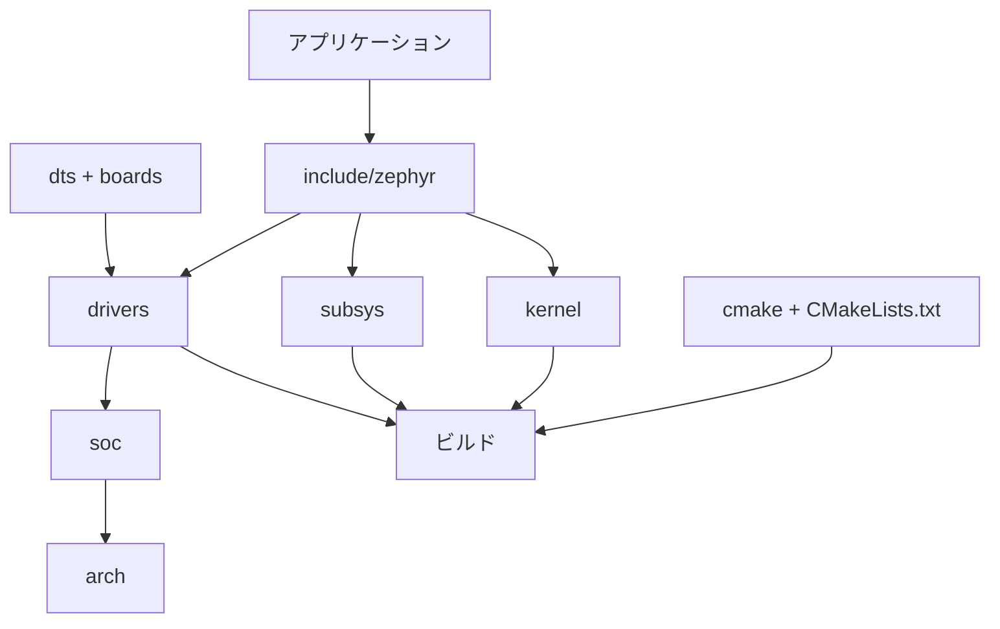

# ソースツリー地図

## 対象範囲

Zephyrリポジトリ直下の主要ディレクトリを、責務と依存方向で整理します。個々のドライバやサブシステムの詳細は扱いません。

## 全体像



## ディレクトリとファイル

| パス | 責務 | 主な接続先 |
| --- | --- | --- |
| `arch/` | CPUアーキテクチャ固有の起動、割り込み、コンテキスト切替 | `kernel/`、`soc/` |
| `boards/` | ボード固有のDevicetree、Kconfig、CMake記述 | `soc/`、`dts/` |
| `cmake/` | ZephyrのCMakeヘルパーとビルドフロー | ルート`CMakeLists.txt` |
| `drivers/` | GPIO、UARTなどのドライバ実装 | `include/zephyr/drivers/`、`dts/` |
| `dts/` | Devicetree処理、バインディング、共通記述 | `boards/`、`soc/`、生成ヘッダ |
| `include/zephyr/` | アプリケーションと内部実装が共有する公開ヘッダ | `kernel/`、`drivers/`、`subsys/` |
| `kernel/` | スレッド、同期、初期化、スケジューラなどの中核 | `arch/`、`include/zephyr/` |
| `soc/` | SoCファミリ・SoC固有の初期化と設定 | `arch/`、`boards/` |
| `subsys/` | ログ、ネットワーク、シェルなどの高位機能 | `kernel/`、`drivers/` |

> **注記: `samples/`と`tests/`**
>
> どちらも製品コードの配置先ではありませんが、APIの使用例と期待動作を探すための有力な入口です。

## 代表的な追跡経路

「applicationの一行がどこへ届くか」を読むときは、次の順に進みます。Canvasは使わず、通常のMarkdownとMermaidで経路を管理します。


この図は読書順を示す補助です。実際のGPIO呼出では、Devicetree・Kconfig・CMakeの入力がbuild時に解決され、初期化後に`struct device`とdriver APIを通じて実装へ到達します。

## 確認方法

```sh
cd zephyr
find . -maxdepth 1 -mindepth 1 -type d -printf '%f\n' | sort
```

## 関連項目

- [ビルドパイプライン](../04-ビルドと設定/00-ビルドパイプライン.md)
- [初期化](../05-カーネル/01-初期化.md)
- [デバイスモデル](../06-ハードウェア抽象化/01-デバイスモデル.md)
- [GPIO呼び出しを追う](../08-追跡演習/03-GPIO呼び出しを追う.md)

## 参照元

- [v4.4.2 リポジトリルート](https://github.com/zephyrproject-rtos/zephyr/tree/v4.4.2)
