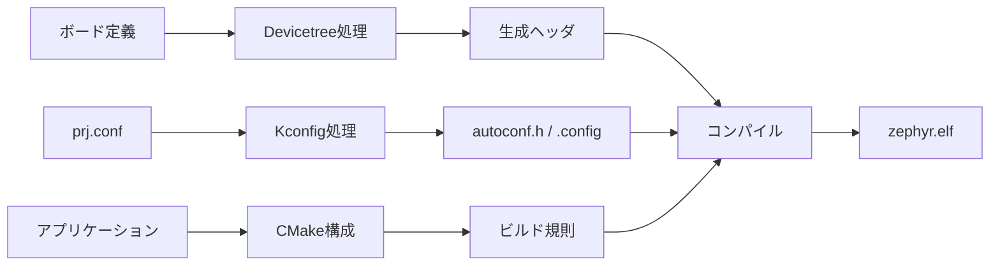

# ビルドパイプライン

## 全体像



## ディレクトリとファイル

- ルートの[`CMakeLists.txt`](https://github.com/zephyrproject-rtos/zephyr/blob/v4.4.2/CMakeLists.txt)がZephyr側のCMake構成の入口です。
- [`Kconfig`](https://github.com/zephyrproject-rtos/zephyr/blob/v4.4.2/Kconfig)はトップレベルの設定ツリーの入口です。
- [`dts/Kconfig`](https://github.com/zephyrproject-rtos/zephyr/blob/v4.4.2/dts/Kconfig)はDevicetree処理に関係する設定を収容します。
- `cmake/`と`scripts/`には、構成・生成段階でCMakeから呼び出される補助ロジックがあります。

## 処理の流れ

1. アプリケーションの`CMakeLists.txt`とボード指定を入力に、CMakeがZephyrの構成を読み込みます。
2. Kconfig処理が設定断片と依存関係を解決し、`.config`と`autoconf.h`を出力します。
3. Devicetree処理がボード記述、SoC記述、オーバーレイ、バインディングを解決し、Cから参照するマクロを生成します。
4. 生成済み設定とヘッダを含めてソースをコンパイルし、リンクしてELFを生成します。

> **注意: 生成物を編集しない**
>
> `build/zephyr/include/generated/`配下は入力ではなく出力です。値を変えるときは、Kconfig、Devicetree、CMakeなど生成元を追跡します。

## 確認方法

```sh
west build -b <board> <application>
find build/zephyr/include/generated -maxdepth 1 -type f | sort
```

## 関連項目

- [Kconfig](01-Kconfig.md)
- [Devicetree](02-Devicetree.md)
- [ソースツリー地図](../03-ソースツリー/00-ソースツリー地図.md)

## 参照元

- [CMakeLists.txt](https://github.com/zephyrproject-rtos/zephyr/blob/v4.4.2/CMakeLists.txt)
- [トップレベルKconfig](https://github.com/zephyrproject-rtos/zephyr/blob/v4.4.2/Kconfig)
