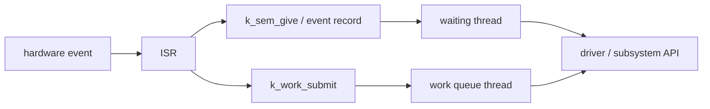

# 実行コンテキスト

## 対象範囲

Zephyrでコードが実行される主な文脈、すなわちthread、割り込みサービスルーチン（Interrupt Service Routine: ISR）、work queueを区別します。特定driverの割り込み設定、CPU例外、SMPの詳細、userspaceの権限分離は扱いません。

## 前提知識

[初期化](01-初期化.md)、[ポインタと構造体からZephyrを読む](../01-Cの基礎/01-ポインタと構造体.md)、[組込みCとZephyrの実装パターン](../01-Cの基礎/02-Zephyrの実装パターン.md)を先に確認してください。`struct device`とdriverの関係は[デバイスモデル](../06-ハードウェア抽象化/01-デバイスモデル.md)を参照します。

## 全体像

同じC関数でも、呼出元の実行コンテキストで使えるAPIと許される待機が変わります。特にISRは短時間でイベントを記録し、時間のかかる処理をthreadまたはwork queueへ渡します。



## ディレクトリとファイル

| パス | 役割 | 重要なsymbol |
| --- | --- | --- |
| `include/zephyr/kernel.h` | thread、kernel object、workの公開API | `k_thread_create()`、`k_work_submit()`、`k_is_in_isr()` |
| `include/zephyr/irq.h` | 割り込み接続・有効化の公開API | `IRQ_CONNECT()`、`irq_enable()` |
| `kernel/thread.c` | thread生成、状態遷移、schedule連携 | `z_setup_new_thread()` |
| `kernel/work.c` | work itemとwork queueの実装 | `k_work_submit()`、`k_work_queue_start()` |
| `kernel/Kconfig` | thread優先度、stack、multithreadingの設定 | `CONFIG_MULTITHREADING`、`CONFIG_MAIN_STACK_SIZE` |

## 処理の流れ

1. [初期化](01-初期化.md)の後、`main()`はmain threadとして実行されます。追加threadはstack、`struct k_thread`、entry function、priorityを持ちます。
2. hardware eventが発生すると、割り込みcontrollerが登録済みISRを呼びます。`IRQ_CONNECT()`の定数引数はbuild時に割り込み表を生成する入力にもなります。
3. ISRでは、長時間の処理や待機を行いません。必要な最小の状態を更新し、semaphoreなどでthreadを起床するか、`k_work_submit()`でwork itemを登録します。
4. waiting threadはkernel objectが利用可能になった時点でreadyになり、schedulerが実行可能なthreadを選びます。work itemは指定work queueに属するthreadがhandlerとして実行します。
5. handlerまたはthread側で、driver API、ログ、通信など待機が必要になり得る処理を行います。ISRから呼べるかは、各APIの`isr-ok`または待機可否を確認します。

> **注意: ISRから待機しない**
>
> ISRはthreadではないため、`K_FOREVER`や時間待ちを要求するAPIを呼べません。ISRから利用可能なAPIでも、timeoutに`K_NO_WAIT`以外を渡せない場合があります。利用前に対象APIの制約を確認してください。

## 設定との対応

| 設定・入力 | 効果 | 確認先 |
| --- | --- | --- |
| `CONFIG_MULTITHREADING` | 追加threadと多くのkernel objectの前提 | `kernel/Kconfig`、`.config` |
| `CONFIG_MAIN_THREAD_PRIORITY` | 初期化から`main()`へ引き継ぐmain threadのpriority | `.config`、`kernel/Kconfig` |
| `CONFIG_MAIN_STACK_SIZE` | main threadが使うstack size | `.config`、map file |
| `IRQ_CONNECT()`の引数 | IRQ、priority、ISR、引数をbuild時の割り込み表生成へ渡す | prebuilt ELF、generated `isr_tables.c` |
| `K_WORK_DEFINE()`または`k_work_init()` | work itemとhandlerを準備する | source、必要に応じてmap file |

## 確認方法

```sh
cd <workspace>/zephyr
git grep -n 'k_is_in_isr' -- include/zephyr/kernel.h kernel
git grep -n '#define IRQ_CONNECT' -- include/zephyr/irq.h
git grep -n 'k_work_submit' -- include/zephyr/kernel.h kernel
git grep -nE '^(config MULTITHREADING|config MAIN_STACK_SIZE|config ISR_STACK_SIZE)' -- kernel/Kconfig
find build -name 'isr_tables.c' -print
```

選んだAPIがISRから使えるかを判断するときは、まず公開headerと公式API文書を読み、次に実際の呼出元を`git grep`で確認します。名前だけでISR対応と判断しません。

## 関連項目

- [初期化](01-初期化.md)
- [スケジューリングと同期](03-スケジューリングと同期.md)
- [メモリ管理](04-メモリ管理.md)
- [実行コンテキストを観察する](../08-追跡演習/05-実行コンテキストを観察する.md)

## 参照元

- [`kernel.h` v4.4.2](https://github.com/zephyrproject-rtos/zephyr/blob/v4.4.2/include/zephyr/kernel.h)
- [`irq.h` v4.4.2](https://github.com/zephyrproject-rtos/zephyr/blob/v4.4.2/include/zephyr/irq.h)
- [`kernel/work.c` v4.4.2](https://github.com/zephyrproject-rtos/zephyr/blob/v4.4.2/kernel/work.c)
- [Threads v4.4.2](https://docs.zephyrproject.org/4.4.2/kernel/services/threads/index.html)
- [Interrupts v4.4.2](https://docs.zephyrproject.org/4.4.2/kernel/services/interrupts.html)
