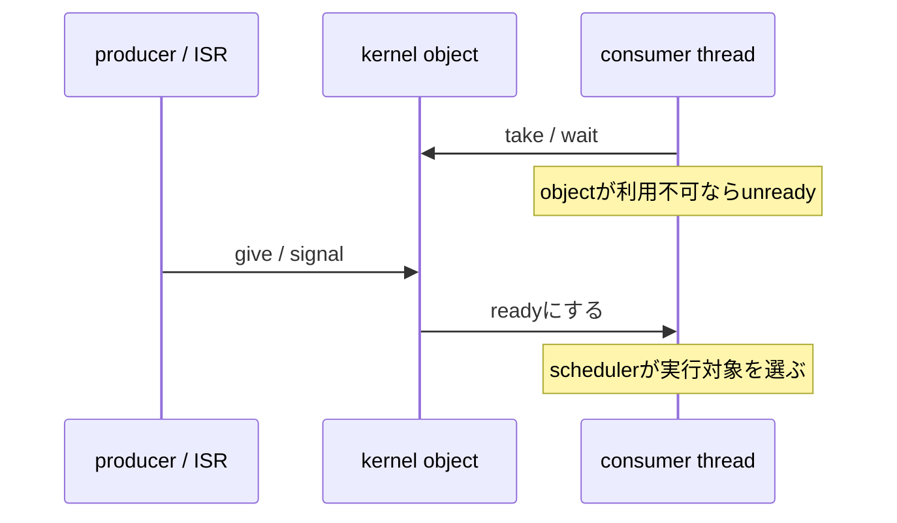

# スケジューリングと同期

## 対象範囲

readyなthreadから実行対象を選ぶschedulerと、thread間・ISRとthread間で状態を渡す基本的なkernel objectを扱います。期限駆動scheduling、SMP affinity、userspace object permission、個別protocolの並行設計は扱いません。

## 前提知識

[実行コンテキスト](02-実行コンテキスト.md)を先に読んでください。ここでいう「待機」は、busy loopではなく、threadがkernel objectまたはtimeoutを待ってunreadyになることです。

## 全体像

優先度は「どのready threadを先に実行するか」を決めます。同期objectは「いつreadyに戻すか」と、共有資源をどう受け渡すかを決めます。優先度だけで排他やデータの正しさを保証するものではありません。



## ディレクトリとファイル

| パス | 役割 | 重要な対象 |
| --- | --- | --- |
| `include/zephyr/kernel.h` | thread priorityとkernel object APIの公開入口 | `K_PRIO_COOP()`、`K_PRIO_PREEMPT()`、`k_sem_*()`、`k_mutex_*()` |
| `kernel/Kconfig` | priority数とschedulerの条件を定義 | `CONFIG_NUM_COOP_PRIORITIES`、`CONFIG_NUM_PREEMPT_PRIORITIES` |
| `kernel/sched.c` | schedulerとready queueの実装 | `z_sched_next_thread()` |
| `kernel/sem.c` | semaphoreの実装 | `z_impl_k_sem_take()`、`z_impl_k_sem_give()` |
| `kernel/mutex.c` | mutexとpriority inheritanceの実装 | `z_impl_k_mutex_lock()` |

## 処理の流れ

1. `kernel/Kconfig`は協調的（cooperative）priority数とpreemptible priority数を定義します。公開macroはその範囲のpriority値を表します。
2. cooperative priorityは負の値、preemptible priorityは0以上の値です。数値が小さい方が高いpriorityです。cooperative threadは自ら待機・譲渡・終了するまで、通常は同じ低priority threadへ切り替わりません。
3. `k_sem_take()`、`k_msgq_get()`などは、objectが利用不可でtimeoutが許されるなら呼出threadを待機状態にします。producerが`give`またはデータ投入をすると、待機threadはreadyになります。
4. 一度に一つのthreadだけが変更すべき共有資源にはmutexを使います。mutexは所有threadを表し、priority inversionを軽減するためのpriority inheritanceを持つ場合があります。
5. ISRからthreadへイベントを渡すときは、ISR対応のobject操作を使い、待機はthread側で行います。ISRでmutexを取って待つ設計にはしません。

> **注記: objectを目的で選ぶ**
>
> 「起きるべき回数・資源の個数」を渡すならsemaphore、「一つの所有者だけが操作する共有資源」を保護するならmutex、「値やメッセージ」を渡すなら対応するqueueを検討します。どれも単なる変数の代替ではなく、待機・起床・所有の規約を持ちます。

## 設定との対応

| 設定 | 依存・効果 | 影響を確認する場所 |
| --- | --- | --- |
| `CONFIG_MULTITHREADING` | threadと多くの待機操作の前提 | `.config`、`kernel/Kconfig` |
| `CONFIG_NUM_COOP_PRIORITIES` | 利用できるcooperative priorityの数 | `.config`、`K_PRIO_COOP()` |
| `CONFIG_NUM_PREEMPT_PRIORITIES` | 利用できるpreemptible priorityの数 | `.config`、`K_PRIO_PREEMPT()` |
| `CONFIG_PRIORITY_CEILING` | mutexのpriority inheritanceが上げられる上限 | `.config`、`kernel/Kconfig` |
| `CONFIG_SCHED_DEADLINE` | 同一priority内の期限ベース選択を有効化 | `.config`、`kernel/Kconfig` |

## 確認方法

```sh
cd <workspace>/zephyr
git grep -nE 'K_PRIO_(COOP|PREEMPT)' -- include/zephyr/kernel.h
git grep -nE '^(config NUM_COOP_PRIORITIES|config NUM_PREEMPT_PRIORITIES|config PRIORITY_CEILING)' -- kernel/Kconfig
git grep -n 'z_sched_next_thread' -- kernel
git grep -n 'z_impl_k_sem_' -- kernel
git grep -n 'z_impl_k_mutex_lock' -- kernel
grep -nE 'CONFIG_(NUM_COOP_PRIORITIES|NUM_PREEMPT_PRIORITIES|PRIORITY_CEILING)=' build/zephyr/.config
```

## 関連項目

- [実行コンテキスト](02-実行コンテキスト.md)
- [メモリ管理](04-メモリ管理.md)
- [実行コンテキストを観察する](../08-追跡演習/05-実行コンテキストを観察する.md)

## 参照元

- [`kernel.h` v4.4.2](https://github.com/zephyrproject-rtos/zephyr/blob/v4.4.2/include/zephyr/kernel.h)
- [`kernel/Kconfig` v4.4.2](https://github.com/zephyrproject-rtos/zephyr/blob/v4.4.2/kernel/Kconfig)
- [`kernel/sched.c` v4.4.2](https://github.com/zephyrproject-rtos/zephyr/blob/v4.4.2/kernel/sched.c)
- [`kernel/sem.c` v4.4.2](https://github.com/zephyrproject-rtos/zephyr/blob/v4.4.2/kernel/sem.c)
- [`kernel/mutex.c` v4.4.2](https://github.com/zephyrproject-rtos/zephyr/blob/v4.4.2/kernel/mutex.c)
- [Scheduling v4.4.2](https://docs.zephyrproject.org/4.4.2/kernel/services/scheduling/index.html)
