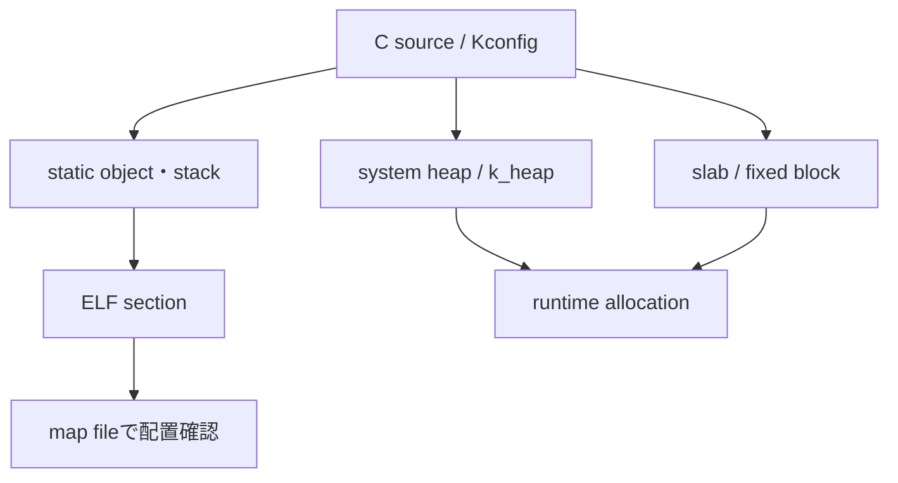

# メモリ管理

## 対象範囲

Zephyr内部を追うために必要な、static object、thread stack、system heap、固定サイズblockの位置付けを扱います。SoCごとのmemory map、MPU/MMUの設定、heap allocatorの性能比較、C library全般のメモリ管理は扱いません。

## 前提知識

[ポインタと構造体からZephyrを読む](../01-Cの基礎/01-ポインタと構造体.md)と[実行コンテキスト](02-実行コンテキスト.md)を先に確認してください。Cのポインタは所有者や寿命を表さないため、objectの定義場所と破棄規約を合わせて読む必要があります。

## 全体像

Zephyrでは、device、thread stack、kernel objectの多くをbuild時に静的に確保します。動的に確保する場合も、どのheapまたはpoolを使うか、失敗時をどう扱うかを明示します。



## ディレクトリとファイル

| パス | 役割 | 重要なsymbol・設定 |
| --- | --- | --- |
| `include/zephyr/kernel.h` | stack、heap、slabの公開API | `K_THREAD_STACK_DEFINE()`、`K_HEAP_DEFINE()`、`K_MEM_SLAB_DEFINE()` |
| `kernel/Kconfig` | main/idle/ISR stackのサイズを決める | `CONFIG_MAIN_STACK_SIZE`、`CONFIG_IDLE_STACK_SIZE`、`CONFIG_ISR_STACK_SIZE` |
| `lib/heap/` | system heapの実装 | `CONFIG_HEAP_MEM_POOL_SIZE` |
| `kernel/mem_slab.c` | 固定サイズblock allocatorの実装 | `k_mem_slab_alloc()`、`k_mem_slab_free()` |
| linker scriptとmap file | sectionを配置し、最終的なsizeを確認する | `zephyr.map` |

## 処理の流れ

1. `K_THREAD_STACK_DEFINE()`や`K_THREAD_DEFINE()`は、thread stack用に必要なalignmentと予約領域を考慮したstatic objectを作ります。任意の`char[]`をportableなthread stackとして渡すことはできません。
2. 初期化から`main()`はmain stackを共有します。sizeは`CONFIG_MAIN_STACK_SIZE`で決まり、ISRはarchitectureと設定に応じて`CONFIG_ISR_STACK_SIZE`のstackを使います。
3. runtimeで可変長または個数不定の領域が必要なら、system heapまたは明示した`k_heap`から確保します。allocationは失敗し得るため、戻り値またはnullを必ず処理します。
4. 同じsizeのbufferを繰り返し受け渡すなら、memory slabを使うと、block数と最大メモリ量をbuild時に上限化できます。
5. build後にmap fileとsize reportを読み、thread stack、BSS、data、heapが実際にどこへどれだけ配置されたかを確認します。C sourceの宣言だけから使用量を断定しません。

> **注意: stack overflowはheap不足とは別問題**
>
> threadごとに必要なstackは呼出深さ、local variable、ISR、compiler、設定で変わります。heapを増やしてもthread stackは増えません。対象buildでstack関連設定と観測機能を有効にし、実測・検証してからsizeを決めます。

## 設定との対応

| 設定 | 効果 | 確認先 |
| --- | --- | --- |
| `CONFIG_MAIN_STACK_SIZE` | 初期化とmain threadのstack size | `.config`、`kernel/Kconfig`、map file |
| `CONFIG_IDLE_STACK_SIZE` | idle threadのstack size | `.config`、map file |
| `CONFIG_ISR_STACK_SIZE` | ISR用stack size | `.config`、map file |
| `CONFIG_HEAP_MEM_POOL_SIZE` | system heap poolのsize | `.config`、map file |
| stack overflow検出関連設定 | guardやsentinelなど、architecture依存の検出を有効化 | Kconfig、対象architectureの文書 |

## 確認方法

```sh
cd <workspace>/zephyr
git grep -n 'K_THREAD_STACK_DEFINE' -- include/zephyr/kernel.h
git grep -n 'K_MEM_SLAB_DEFINE' -- include/zephyr/kernel.h
git grep -nE '^(config MAIN_STACK_SIZE|config IDLE_STACK_SIZE|config ISR_STACK_SIZE)' -- kernel/Kconfig
grep -nE 'CONFIG_(MAIN_STACK_SIZE|IDLE_STACK_SIZE|ISR_STACK_SIZE|HEAP_MEM_POOL_SIZE)=' build/zephyr/.config
find build -name zephyr.map -print
```

## 関連項目

- [実行コンテキスト](02-実行コンテキスト.md)
- [スケジューリングと同期](03-スケジューリングと同期.md)
- [成果物を読む](../02-開発環境/05-成果物を読む.md)

## 参照元

- [`kernel.h` v4.4.2](https://github.com/zephyrproject-rtos/zephyr/blob/v4.4.2/include/zephyr/kernel.h)
- [`kernel/Kconfig` v4.4.2](https://github.com/zephyrproject-rtos/zephyr/blob/v4.4.2/kernel/Kconfig)
- [`kernel/mem_slab.c` v4.4.2](https://github.com/zephyrproject-rtos/zephyr/blob/v4.4.2/kernel/mem_slab.c)
- [Memory management v4.4.2](https://docs.zephyrproject.org/4.4.2/kernel/memory_management/index.html)
