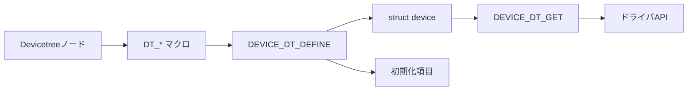

# デバイスモデル

## 対象範囲

Devicetreeノードが、初期化される`struct device`とドライバAPIへ接続される基本経路を扱います。

## 全体像



## ディレクトリとファイル

| パス | 役割 |
| --- | --- |
| `include/zephyr/device.h` | `struct device`と、Devicetree対応のデバイス定義・取得マクロを提供する。 |
| `include/zephyr/devicetree.h` | ノードラベル、エイリアス、プロパティをCマクロへ写像する。 |
| `drivers/` | 各ドライバが、対応するDevicetreeノードからデバイス実体を定義する。 |
| `kernel/init.c` | 初期化レベルでデバイスの初期化関数を呼ぶ。 |

## 処理の流れ

1. Devicetree処理がノードとプロパティをCマクロとして生成します。
2. ドライバは[`DEVICE_DT_DEFINE()`](https://github.com/zephyrproject-rtos/zephyr/blob/v4.4.2/include/zephyr/device.h#L259-L284)で、ノードに対応するデバイス、構成、状態、初期化情報、API表を定義します。
3. 初期化時に`kernel/init.c`がデバイスの初期化関数を呼び、結果をデバイス状態へ記録します。
4. アプリケーションまたは上位層は[`DEVICE_DT_GET()`](https://github.com/zephyrproject-rtos/zephyr/blob/v4.4.2/include/zephyr/device.h#L317-L324)で対応する`struct device`を取得し、型別APIを呼びます。
5. 利用前には、`device_is_ready()`または型別の`*_is_ready_dt()`で初期化成功を確認します。

> **注記: Devicetreeとデバイスは同一ではない**
>
> Devicetreeノードはビルド時の記述です。`struct device`は、そのノードを基に生成・登録され、実行時に状態とAPIを持つオブジェクトです。

## 確認方法

```sh
git grep -n 'DEVICE_DT_DEFINE' -- drivers | head
git grep -n '#define DEVICE_DT_GET' -- include/zephyr/device.h
```

## 関連項目

- [Devicetree](../04-ビルドと設定/02-Devicetree.md)
- [初期化](../05-カーネル/01-初期化.md)
- [GPIO呼び出しを追う](../08-追跡演習/03-GPIO呼び出しを追う.md)

## 参照元

- [include/zephyr/device.h](https://github.com/zephyrproject-rtos/zephyr/blob/v4.4.2/include/zephyr/device.h)
- [include/zephyr/devicetree.h](https://github.com/zephyrproject-rtos/zephyr/blob/v4.4.2/include/zephyr/devicetree.h)
- [kernel/init.c](https://github.com/zephyrproject-rtos/zephyr/blob/v4.4.2/kernel/init.c)
