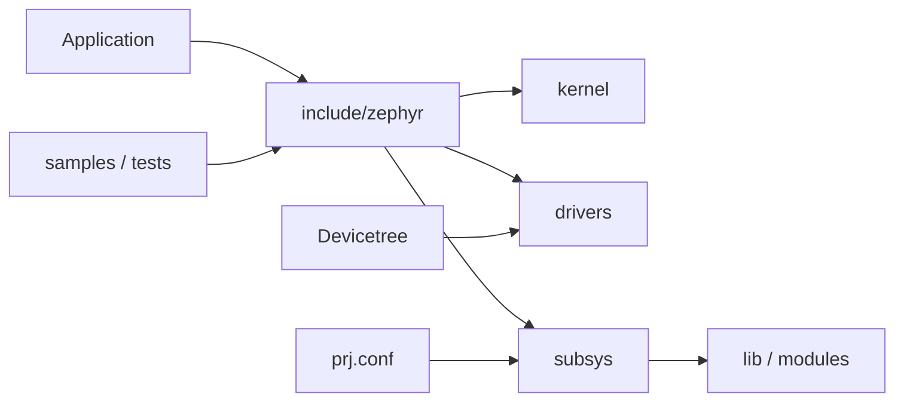

# Zephyr提供機能の地図

## 対象範囲

実現したい機能から、Zephyrの公開API、設定、Devicetree、実装、sample・testへ入る起点を選ぶための地図です。各APIの完全な仕様や個別protocolの設計は扱いません。

## 全体像



> **注記: 段階4へ進む条件**
>
> この地図は、[実行コンテキスト](../05-カーネル/02-実行コンテキスト.md)までを読み、application・Kconfig・Devicetree・生成物の関係を一度追った後に使います。機能名から直接`subsys/`を読むのではなく、公開headerとsampleを入口にします。

## ディレクトリとファイル

| 目的 | API・設定の入口 | 主な実装 | 構成上の注意 | 最初に見るsample/test |
| --- | --- | --- | --- | --- |
| thread、同期、timer、work queue | `include/zephyr/kernel.h`、`CONFIG_*` | `kernel/` | ISRとthreadで使えるAPIは異なる | `samples/kernel/`、`samples/synchronization/` |
| GPIO、UART、I2C、SPI、sensor | `include/zephyr/drivers/`、`DT_*` | `drivers/`、`soc/`、HAL module | node status、binding、pin control、driver Kconfigが連動 | `samples/drivers/`、[GPIO呼び出しを追う](../08-追跡演習/03-GPIO呼び出しを追う.md) |
| log、console、shell | `include/zephyr/logging/`、`CONFIG_LOG`など | `subsys/logging/`、`subsys/shell/` | backendと出力deviceの両方を選ぶ | [ログ](02-ログ.md)、`samples/subsys/` |
| IP network、socket | `include/zephyr/net/`、`CONFIG_NETWORKING` | `subsys/net/` | link-layer driver、ネットワーク設定、boardが影響 | `samples/net/` |
| Bluetooth | `include/zephyr/bluetooth/`、`CONFIG_BT` | `subsys/bluetooth/`、controller/HAL | controller、radio、board・module依存を確認 | `samples/bluetooth/` |
| storage、file system | `include/zephyr/storage/`、`fs/` API | `subsys/storage/`、`subsys/fs/`、`modules/fs/` | partition、flash node、外部FS moduleが必要な場合がある | `samples/subsys/` |
| boot、image signing、security | image/boot APIと`CONFIG_*` | `subsys/`、`bootloader/`、crypto module | trust zone、bootloader、鍵、boardの組合せに依存 | `samples/tfm_integration/`、`samples/psa/` |
| debug、trace、coverage | logging、shell、debug Kconfig | `subsys/debug/`、`modules/debug/` | probe・host tool・target capabilityが必要 | `samples/subsys/` |
| unit/integration test、simulation | Twister YAML、ztest API | `tests/`、`scripts/twister` | platform、harness、emulatorにより実行可否が変わる | `tests/`、[開発・解析コマンド](../02-開発環境/06-開発・解析コマンド.md) |

## 処理の流れ

1. 目的に対応する公開headerとsampleを特定します。
2. sampleの`CMakeLists.txt`、`prj.conf`、overlay、`src/`から、必要なCMake・Kconfig・Devicetree入力を確認します。
3. 公開APIの宣言から、`subsys/`、`drivers/`、`kernel/`の実装へ検索を進めます。
4. board依存の要素は、`zephyr.dts`、`.config`、map file、runner設定をビルドごとに確認します。

目的別の機能を選んだ後も、調査の順序は同じです。

| 調査順 | 確認する問い |
| --- | --- |
| 1. APIとsample | applicationから何を呼び、どの最小設定を要求するか |
| 2. Kconfig | 機能を有効にするsymbol、依存、既定値は何か |
| 3. Devicetree | 実体となるdevice、接続、`chosen`またはaliasは何か |
| 4. 実装 | API表、subsystem、driverのどこで処理が続くか |
| 5. test | 選んだ設定・platformで、どの性質を検証しているか |

## 設定との対応

機能の有効・無効は原則Kconfig、物理deviceと接続はDevicetree、コンパイル単位と外部module探索はCMake/manifestで決まります。同じ機能でも、SoC・board・選択したmodule・有効な設定によって実装経路が変わります。

## 確認方法

```sh
cd <workspace>/zephyr
find samples -maxdepth 2 -mindepth 2 -type d | sort | head -80
find tests -name '*.yaml' -o -name 'testcase.yaml' | head
git grep -n '^config LOG$' -- subsys
git grep -n '^config BT$' -- subsys
```

## 関連項目

- [ソースツリー地図](../03-ソースツリー/00-ソースツリー地図.md)
- [Kconfig](../04-ビルドと設定/01-Kconfig.md)
- [デバイスモデル](../06-ハードウェア抽象化/01-デバイスモデル.md)
- [ログ](02-ログ.md)

## 参照元

- [Zephyr source tree v4.4.2](https://github.com/zephyrproject-rtos/zephyr/tree/v4.4.2)
- [Samples v4.4.2](https://github.com/zephyrproject-rtos/zephyr/tree/v4.4.2/samples)
- [Tests v4.4.2](https://github.com/zephyrproject-rtos/zephyr/tree/v4.4.2/tests)
- [Twister v4.4.2](https://docs.zephyrproject.org/4.4.2/develop/test/twister.html)
- [`subsys/Kconfig` v4.4.2](https://github.com/zephyrproject-rtos/zephyr/blob/v4.4.2/subsys/Kconfig)
