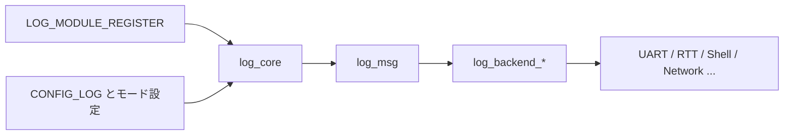

# ログ

## 対象範囲

Zephyrのロギングサブシステムを、モジュール登録、設定、コア処理、出力バックエンドの境界から整理します。個別バックエンドの設定値は、後続の記事で扱います。

## 全体像



## ディレクトリとファイル

| パス | 役割 |
| --- | --- |
| `include/zephyr/logging/` | アプリケーションとバックエンドが利用する公開ログAPI。 |
| `subsys/logging/Kconfig` | ログのトップレベル設定と下位設定ツリーの入口。 |
| `subsys/logging/log_core.c` | ログコアの実装。 |
| `subsys/logging/log_msg.c` | ログメッセージの生成・保持。 |
| `subsys/logging/backends/` | UART、RTT、ネットワークなどの出力バックエンド。 |
| `subsys/logging/frontends/` | フロントエンド実装と対応設定。 |

## 処理の流れ

1. 各モジュールが`LOG_MODULE_REGISTER()`で名前と既定レベルを登録します。
2. `CONFIG_LOG`とモード関連設定が、ログコード・メッセージ保持・処理方式を選択します。
3. ログマクロはログコアにメッセージを渡します。即時・遅延などの方式によって、出力タイミングと実行コンテキストが変わります。
4. 有効なバックエンドがメッセージを整形し、UART、RTT、シェル、ネットワークなどへ出力します。

## 設定との対応

[`subsys/logging/Kconfig`](https://github.com/zephyrproject-rtos/zephyr/blob/v4.4.2/subsys/logging/Kconfig)の`LOG`が設定ツリーの入口です。モード、処理、書式、フィルタ、バックエンドの設定は同ディレクトリの分割Kconfigへ続きます。特定の設定を説明するときは、定義だけでなく`subsys/logging/CMakeLists.txt`で取り込まれる実装まで追跡します。

## 確認方法

```sh
git grep -n '^config LOG$' -- subsys/logging
git grep -n 'LOG_MODULE_REGISTER' -- samples subsys drivers | head
find subsys/logging/backends -maxdepth 1 -type f | sort
```

## 関連項目

- [Kconfig](../04-ビルドと設定/01-Kconfig.md)
- [初期化](../05-カーネル/01-初期化.md)

## 参照元

- [subsys/logging](https://github.com/zephyrproject-rtos/zephyr/tree/v4.4.2/subsys/logging)
- [logging Kconfig](https://github.com/zephyrproject-rtos/zephyr/blob/v4.4.2/subsys/logging/Kconfig)
- [ログ公開ヘッダ](https://github.com/zephyrproject-rtos/zephyr/tree/v4.4.2/include/zephyr/logging)
