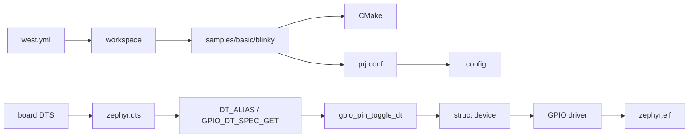

# 導入環境からBlinkyを追う

## 対象範囲

公式`Blinky` sampleを出発点に、west workspace、アプリケーション入力、Kconfig・Devicetree生成物、GPIO API、device・driver、最終ELFまでを一続きで追います。特定boardへの書き込み手順、LEDの電気的特性、特定SoCのGPIOレジスタ実装は扱いません。

## 前提知識

[導入手順と確認](../02-開発環境/02-導入手順と確認.md)、[成果物を読む](../02-開発環境/05-成果物を読む.md)、[Devicetree](../04-ビルドと設定/02-Devicetree.md)を確認してください。

## 全体像



## ディレクトリとファイル

| パス | 読む目的 | 次に進む先 |
| --- | --- | --- |
| `<workspace>/.west/config` | 現在のworkspaceとmanifestの入口を確認する | `zephyr/west.yml` |
| `zephyr/west.yml` | Zephyr本体とmoduleのrevision・配置を確認する | `samples/basic/blinky/` |
| `samples/basic/blinky/CMakeLists.txt` | appをZephyr CMake buildへ接続する記述を確認する | build directory |
| `samples/basic/blinky/prj.conf` | sampleが要求するKconfig fragmentを確認する | `build/zephyr/.config` |
| `samples/basic/blinky/src/main.c` | `led0` aliasとGPIO APIの使用を確認する | generated DTS、GPIO header |
| `samples/basic/blinky/boards/` | board固有のsample overlayがあるか確認する | 選んだboardのDTS |
| `build/zephyr/zephyr.dts` | 実際に選ばれた`led0`とGPIO controllerを確認する | generated DT header |
| `include/zephyr/drivers/gpio.h` | `gpio_dt_spec`とGPIO APIの宣言を確認する | driver implementation |

## 処理の流れ

1. workspace rootで`west manifest --resolve`を実行し、`zephyr`とmoduleが対象revisionにあることを確認します。`west.yml`はBlinkyの機能選択ではなく、Blinkyをビルドできるソース集合の固定です。
2. `zephyr` directoryで`west build -p always -b <board> samples/basic/blinky`を実行します。`<board>`は`west boards`で確認し、Blinkyの要件を満たすboardを選びます。
3. CMakeがsampleの`CMakeLists.txt`を入口に、Zephyr CMake package、board、toolchainを構成します。結果は`CMakeCache.txt`と`build.ninja`です。
4. Kconfigはsampleの`prj.conf`とboard/SoC由来の設定を解決し、`build/zephyr/.config`と`autoconf.h`を出力します。
5. Devicetree処理はboard・SoC記述とsampleの適用可能なoverlayを合成し、`build/zephyr/zephyr.dts`を出力します。ここで`aliases { led0 = ...; }`と対象nodeの`gpios`を確認します。
6. `main.c`の`DT_ALIAS(led0)`と`GPIO_DT_SPEC_GET()`は、生成されたDevicetree macroから`struct gpio_dt_spec`の初期化子を作ります。
7. `gpio_is_ready_dt()`、`gpio_pin_configure_dt()`、`gpio_pin_toggle_dt()`は、そのspecが指す`struct device`のGPIO driver APIへ到達します。deviceはdriverの`DEVICE_DT_DEFINE()`などにより、同じDevicetree nodeから登録されています。
8. compilerとlinkerはapp、kernel、driver、生成物を一つの`build/zephyr/zephyr.elf`へリンクします。`zephyr.map`があれば、Blinky由来のsymbolやGPIO driverのsection配置を確認できます。

> **注記: `led0`は固定ピン名ではない**
>
> `led0`はDevicetree aliasです。対象GPIO controller、pin、active levelはboardとoverlayで変わります。BlinkyのCソースだけを読んで、特定のSoC pinやdriverを断定しません。

## 設定との対応

| 観察したいもの | 入力 | ビルド後の確認先 |
| --- | --- | --- |
| boardの選択 | `west build -b <board>` | `CMakeCache.txt`、`zephyr.dts` |
| ソフトウェア機能 | sampleの`prj.conf`、board/SoC Kconfig | `.config`、`autoconf.h` |
| LEDとGPIO接続 | board DTS、sample overlay | `zephyr.dts`、generated DT header |
| driverの実装選択 | nodeの`compatible`、driver Kconfig、SoC | `drivers/gpio/`、`.config`、map file |

## 確認方法

```sh
cd <workspace>/zephyr
west manifest --resolve | grep -E '(^  - name: zephyr$|path: zephyr|revision:)'
west boards | head
west build -p always -b <board> samples/basic/blinky
grep -nE 'aliases|led0|gpios' build/zephyr/zephyr.dts
grep -n 'CONFIG_GPIO' build/zephyr/.config
git grep -n 'gpio_pin_toggle_dt' -- include/zephyr/drivers/gpio.h
git grep -n 'DEVICE_DT_DEFINE' -- drivers/gpio | head
```

boardにLED aliasがない場合は、Blinkyの[requirements](https://docs.zephyrproject.org/4.4.2/samples/basic/blinky/README.html)を確認し、対応boardまたは適切なoverlayを選びます。

## 関連項目

- [ワークスペースの構造](../02-開発環境/03-ワークスペースの構造.md)
- [成果物を読む](../02-開発環境/05-成果物を読む.md)
- [デバイスモデル](../06-ハードウェア抽象化/01-デバイスモデル.md)
- [GPIO呼び出しを追う](03-GPIO呼び出しを追う.md)

## 参照元

- [Blinky `main.c` v4.4.2](https://github.com/zephyrproject-rtos/zephyr/blob/v4.4.2/samples/basic/blinky/src/main.c)
- [Blinky sample v4.4.2](https://docs.zephyrproject.org/4.4.2/samples/basic/blinky/README.html)
- [`gpio.h` v4.4.2](https://github.com/zephyrproject-rtos/zephyr/blob/v4.4.2/include/zephyr/drivers/gpio.h)
- [`device.h` v4.4.2](https://github.com/zephyrproject-rtos/zephyr/blob/v4.4.2/include/zephyr/device.h)
