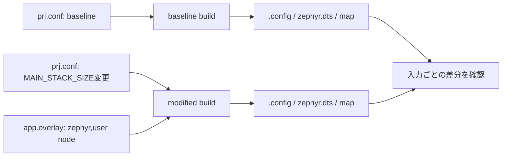

# Blinkyの設定差分を観察する

## 出発点

この演習では、nRF52840 DKを対象にBlinkyの入力を一つずつ変え、変更が`.config`、`zephyr.dts`、map fileへどう反映されるかを確認します。LEDの点滅だけを成功条件にせず、入力と生成物を対応付けることを目的にします。

> **注意: 公式sampleを直接編集しない**
>
> `<workspace>/zephyr/samples/basic/blinky`は対象タグの参照元です。演習では別のapplication directoryへコピーするか、独自applicationからsampleを参照し、変更点を自分の入力だけに限定します。

## ビルド時の接続



1. `<workspace>/zephyr`でBlinkyをbaseline用のbuild directoryへ構成します。board targetはnRF Connect for VS Codeのbuild configurationに表示されたnRF52840 DKのtarget、または`west boards`で確認したtargetを使います。
2. 次に、コピーしたapplicationの`prj.conf`へ`CONFIG_MAIN_STACK_SIZE=2048`を追加し、別のbuild directoryへpristine buildします。この変更はLEDの接続ではなく、main threadのstack sizeを変えるKconfig入力です。
3. 同じapplicationに`app.overlay`を追加し、`/ { zephyr,user { label = "blinky-observe"; }; };`のようなapplication専用nodeを記述します。このnodeはBlinkyの動作を変えず、overlayが最終`zephyr.dts`へ結合されることだけを確認するための入力です。
4. baselineと変更後の`.config`、`zephyr.dts`、map fileを比較します。Kconfig入力は`.config`に、overlay入力は`zephyr.dts`に現れることを確認します。

## 実行時の接続

この演習で実機へflashする場合、BlinkyがLEDをtoggleする経路は変わりません。`CONFIG_MAIN_STACK_SIZE`と`zephyr,user` nodeは、GPIO APIやGPIO driverを切り替える入力ではないためです。動作の同一性と、build時の生成物差分を分けて説明してください。

## 確認方法

以下の`<board>`は、実際に使用したnRF52840 DKのboard targetで置き換えます。

```sh
cd <workspace>/zephyr
west boards | grep -i nrf52840
west build -p always -d build-blinky-base -b <board> samples/basic/blinky
west build -p always -d build-blinky-observe -b <board> <your-application>

grep -n 'CONFIG_MAIN_STACK_SIZE' build-blinky-base/zephyr/.config
grep -n 'CONFIG_MAIN_STACK_SIZE' build-blinky-observe/zephyr/.config
grep -n 'blinky-observe' build-blinky-observe/zephyr/zephyr.dts
diff -u build-blinky-base/zephyr/.config build-blinky-observe/zephyr/.config
find build-blinky-observe -name zephyr.map -print
```

完了条件は次の三つです。

1. `CONFIG_MAIN_STACK_SIZE`の値が変更後の`.config`で確認できる。
2. `blinky-observe`が変更後の`zephyr.dts`だけに現れる。
3. この二つの入力が、LED alias・`gpios`・GPIO driverを変えていないと説明できる。

## 関連項目

- [nRF Connect for VS Codeで観察する](../02-開発環境/01-nRF Connect for VS Codeで観察する.md)
- [Kconfig](../04-ビルドと設定/01-Kconfig.md)
- [Devicetree](../04-ビルドと設定/02-Devicetree.md)
- [メモリ管理](../05-カーネル/04-メモリ管理.md)
- [導入環境からBlinkyを追う](01-導入環境からBlinkyを追う.md)

## 参照元

- [Blinky sample v4.4.2](https://github.com/zephyrproject-rtos/zephyr/tree/v4.4.2/samples/basic/blinky)
- [`main.c` v4.4.2](https://github.com/zephyrproject-rtos/zephyr/blob/v4.4.2/samples/basic/blinky/src/main.c)
- [`kernel/Kconfig` v4.4.2](https://github.com/zephyrproject-rtos/zephyr/blob/v4.4.2/kernel/Kconfig)
- [Devicetree overlays v4.4.2](https://docs.zephyrproject.org/4.4.2/build/dts/howtos.html)
