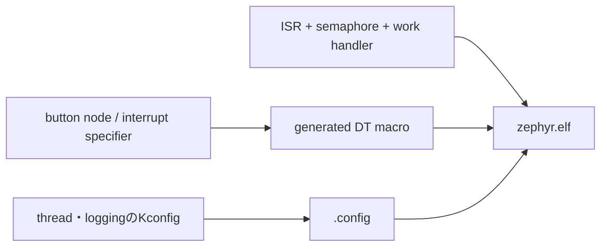

# 実行コンテキストを観察する

## 出発点

thread、ISR、work queueは、同じ「関数を実行する」仕組みではありません。この演習では、hardware eventからISRを経由してthreadまたはwork handlerへ処理を渡す経路を、source、ログ、生成物で確認します。特定のbutton回路やGPIO pinは前提にしません。

## ビルド時の接続



1. `samples/`で`k_work_submit`、`k_sem_give`、`gpio_add_callback`を使うsampleを検索し、対象boardで利用できるものを選びます。
2. sampleの`CMakeLists.txt`、`prj.conf`、overlay、`src/`を読み、button node、interrupt callback、threadまたはwork handlerの入口を特定します。
3. `IRQ_CONNECT()`を直接使うdriverでは、`include/zephyr/irq.h`と生成される`isr_tables.c`を確認します。GPIO callbackを使うapplicationでは、IRQ登録はGPIO driverの内部にあり、applicationはdriver callbackを登録します。この二つを混同しません。
4. loggingを有効にする変更を行うなら、ログ出力を「タイミングの観察用」と扱い、ISR内で時間のかかるformat処理を行う設計にはしません。

## 実行時の接続

1. input eventが発生すると、GPIO controllerのIRQ処理がcallbackを呼びます。このcallbackはISR文脈で呼ばれ得ます。
2. callbackはeventを記録し、semaphoreをgiveするか、work itemをsubmitします。
3. semaphoreを待つthread、またはwork queueのthreadが後続処理を行います。ここでのみ、待機やdriver操作を含む処理を検討します。
4. handler内で`k_is_in_isr()`を確認する最小の観察コードを使う場合、その戻り値は「今実行している場所」を示すだけです。ISRから安全でない処理を安全にするものではありません。

> **注記: 実機が使えない場合**
>
> 同一のGPIO割り込みをシミュレータで再現することは目的にしません。thread、semaphore、work queueの関係は、対象タグの`tests/kernel/`と`tests/subsys/`から対象APIのtestを探し、Twisterで対応platformを実行して確認します。

## 確認方法

```sh
cd <workspace>/zephyr
git grep -nE 'k_work_submit|k_sem_give|gpio_add_callback' -- samples tests | head -80
git grep -n 'k_is_in_isr' -- include/zephyr/kernel.h kernel
git grep -n '#define IRQ_CONNECT' -- include/zephyr/irq.h
find build -name isr_tables.c -print
find tests -name 'testcase.yaml' | head -40
```

選んだsampleをbuildした後、次を根拠に経路を図示できれば完了です。

| 確認対象 | 確認するもの |
| --- | --- |
| 入力 | `prj.conf`、overlay、buttonまたはdriver node |
| ISRへの到達 | GPIO driverのcallback登録または`IRQ_CONNECT()` |
| 受け渡し | semaphore、event、queue、work itemのいずれか |
| 後続実行 | thread entryまたはwork handler |
| build結果 | `.config`、`zephyr.dts`、必要なら`isr_tables.c` |

## 関連項目

- [実行コンテキスト](../05-カーネル/02-実行コンテキスト.md)
- [スケジューリングと同期](../05-カーネル/03-スケジューリングと同期.md)
- [メモリ管理](../05-カーネル/04-メモリ管理.md)
- [開発・解析コマンド](../02-開発環境/06-開発・解析コマンド.md)

## 参照元

- [`kernel.h` v4.4.2](https://github.com/zephyrproject-rtos/zephyr/blob/v4.4.2/include/zephyr/kernel.h)
- [`irq.h` v4.4.2](https://github.com/zephyrproject-rtos/zephyr/blob/v4.4.2/include/zephyr/irq.h)
- [`kernel/work.c` v4.4.2](https://github.com/zephyrproject-rtos/zephyr/blob/v4.4.2/kernel/work.c)
- [Interrupts v4.4.2](https://docs.zephyrproject.org/4.4.2/kernel/services/interrupts.html)
- [Twister v4.4.2](https://docs.zephyrproject.org/4.4.2/develop/test/twister.html)
