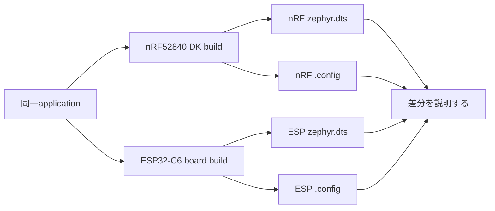

# ボード差分を観察する

## 出発点

同じapplicationをnRF52840 DKとESP32-C6-WROOM-1搭載基板でbuildし、C sourceが同じでもboard、SoC、Devicetree、Kconfig、runnerにより最終結果が変わることを確認します。この演習は、特定のESP32-C6搭載基板のboard定義やflash手順を提供しません。

## ビルド時の接続



1. nRF52840 DKでbuild済みのapplicationを基準にします。
2. ESP32-C6-WROOM-1搭載基板については、使用するSDKにboard targetが存在すること、boardのDTSとrunner設定がどのリポジトリにあるかを先に確認します。市販基板・自作基板・NCSのSDKではtarget名と定義場所が異なり得ます。
3. 同じapplicationを別のbuild directoryへ構成します。board固有のoverlayが必要なら、それをapplication共通入力と混ぜず、適用条件と目的を記録します。
4. `zephyr.dts`で`chosen`、`aliases`、GPIO controller、consoleを、`.config`でarchitecture・driver・console関連の有効設定を比較します。
5. 差分を「applicationのロジック差」ではなく「board/SoCが入力に加わった結果」として説明します。

## 実行時の接続

applicationが`DT_ALIAS(led0)`や`DEVICE_DT_GET()`を使う場合、C sourceは同じでも、その参照先のdeviceとdriverはboardごとに変わり得ます。実機で同じ出力が得られても、pin番号、console、flash runner、driver implementationが同一とは限りません。

## 確認方法

```sh
cd <workspace>/zephyr
west boards | grep -Ei 'nrf52840|esp32c6'
west build -p always -d build-nrf -b <nrf-board> <application>
west build -p always -d build-esp -b <esp-board> <application>

diff -u build-nrf/zephyr/zephyr.dts build-esp/zephyr/zephyr.dts | sed -n '1,240p'
diff -u build-nrf/zephyr/.config build-esp/zephyr/.config | sed -n '1,240p'
find build-nrf build-esp -path '*/zephyr/zephyr.dts' -o -name CMakeCache.txt
```

`<esp-board>`が一覧にない場合、そのSDKでは対象基板のboard定義が提供されていません。仮のtarget名を作らず、実在するboard定義またはcustom boardのソースを用意してから続けます。

## 関連項目

- [ワークスペースの構造](../02-開発環境/03-ワークスペースの構造.md)
- [Devicetree](../04-ビルドと設定/02-Devicetree.md)
- [Kconfig](../04-ビルドと設定/01-Kconfig.md)
- [導入環境からBlinkyを追う](01-導入環境からBlinkyを追う.md)
- [Blinkyの設定差分を観察する](02-Blinkyの設定差分を観察する.md)

## 参照元

- [Board porting guide v4.4.2](https://docs.zephyrproject.org/4.4.2/hardware/porting/board_porting.html)
- [Devicetree how-to v4.4.2](https://docs.zephyrproject.org/4.4.2/build/dts/howtos.html)
- [`boards/` v4.4.2](https://github.com/zephyrproject-rtos/zephyr/tree/v4.4.2/boards)
